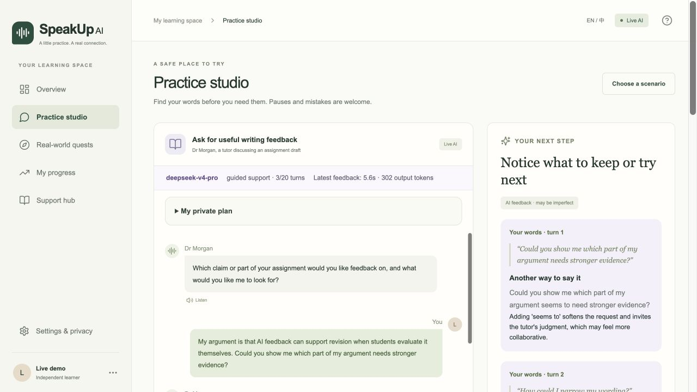

# SpeakUp AI

A full-stack educational prototype for academic communication and help-seeking in English-medium university study. Students prepare privately, rehearse a conversation, evaluate feedback, and choose an optional human interaction or support request.

**中文说明：** 这是 INT7115 课程项目的可运行版本，包含前端、Node.js 后端、SQLite 和可选 DeepSeek API。没有密钥也可使用明确标注的 Demo 模式。GitHub 仓库用于下载代码和协作，不是多人在线服务。

- [项目制作和软件流程完整讲解（中文）](docs/10-project-walkthrough-zh.md)
- [四人展示逐页讲解、英文讲稿和问答](docs/11-presentation-rehearsal-zh-en.md)
- [Editable presentation: 10 main slides and 5 backup slides](presentation/SpeakUp-AI-slides.pptx)
- [Four-person presentation plan](presentation/SpeakUp-AI-four-person-plan.md)
- [Literature evidence matrix for the 30 supplied papers](docs/08-literature-evidence-matrix.md)
- [Feature decisions and dated verification record](docs/09-literature-driven-upgrade.md)

## Clone and run

Install **Node.js 22.13 or newer**; Node 24 LTS is a suitable choice. The backend requires Node's built-in SQLite, so Node 20 is insufficient.

```bash
git clone https://github.com/wangnb002004-hue/speakup-ai.git
cd speakup-ai
npm ci
npm run dev
```

Open **http://127.0.0.1:4311/**. Complete the learning profile using a nickname. No extra account, database server or API key is required for the scripted demo. Each clone starts without learner records.

If another local application uses the port:

```bash
npm run dev -- --port 4312
```

For a local production build:

```bash
npm run build
npm start
```

On macOS, `启动 SpeakUp AI.command` or `npm run launch` can install missing dependencies, build and open the app. The launcher may reuse an existing SpeakUp service; check its printed address when working with several copies. Foreground services need their terminal to remain open.

## Connect your own DeepSeek API

```bash
cp .env.example .env.local
```

Edit `.env.local` locally:

```dotenv
LLM_API_URL=https://api.deepseek.com/chat/completions
LLM_API_KEY=your-own-key
LLM_MODEL=deepseek-v4-pro
LLM_PROVIDER=deepseek
SPEAKUP_DEMO=false
```

The example model is configurable. Use a model available to your provider account. Restart the server after changing configuration, then choose **Settings & privacy → Test connection**. Review remote-AI consent in your learning profile and start a **new practice**. Historical demo practices keep their scripted label.

The repository does not contain a working API key. Never commit `.env.local`. API requests can consume the account's credits. Provider errors are shown explicitly, without substituting a demo response.

## Learning workflow

1. Choose one of six situations: seminar discussion, campus connection, group project, office hours, a targeted assignment-feedback request, or lecture clarification.
2. Make a private plan and choose a strategy. Multilingual notes and context-specific confidence/willingness check-ins are optional.
3. Rehearse using guided, natural or stretch support. Show or hide phrase hints. Replies can stream, be stopped and safely retried.
4. Inspect feedback that quotes the learner's actual words, offers an alternative and explains it. Save phrases and write what to keep, adapt or question.
5. Rehearse again, or prepare an optional human task with an opening, suitable moment and respectful exit.
6. Record the actual experience, including intentional listening, limited speaking space or no opportunity. Support hub separately records questions, contact plans and self-reported follow-up.

These are reflection records. Preparing a plan, reading a service page or choosing to listen never counts as an actual speaking attempt. Confidence does not automatically change challenge. This project has not established learning gains or improved real-world willingness to communicate.

## Where AI is used

- **Model-generated:** contextual role-play replies and text-based coaching. A second rehearsal can carry forward earlier coaching.
- **Authored or rule-based:** scenario descriptions, example academic moves, recommendation explanations and support planning.
- **Student-reported:** human interactions, participation choices, contextual ratings and support usefulness.

This is API integration, not a newly trained model, fine-tuned model or retrieval-augmented generation system. Exact quotation checks verify attribution; they do not prove that the advice is correct. There are no pronunciation grades, proficiency rankings or clinical diagnoses.

## Architecture and data

The React interface calls same-origin Next.js route handlers. The Node backend validates input, identifies an anonymous browser session with an HttpOnly cookie, stores records in SQLite and calls DeepSeek when the learner has opted in.

- `.env.local`: server-only configuration, ignored by Git.
- `data/speakup.sqlite`: default local storage, generated at runtime and ignored by Git.
- Practice messages, scenario, support choice and the separately consented profile goal can enter AI requests.
- The private plan, multilingual note, contextual ratings, self-review and support plan are excluded from model prompts.
- Optional browser speech recognition can process audio through the browser's service. SpeakUp stores reviewed text, not audio. Typing always remains available.
- Settings supports export and deletion of the current local session. Storage is not encrypted at rest; deletion cannot remove previous provider copies or backups.

The server binds to loopback. Shared public deployment, institutional login and cross-device sync require additional work. See [system design](docs/02-system-design.md).

## Verification

```bash
npm run lint
npm run typecheck
npm test
npm run build
```

The API runner starts a production server on a free loopback port, uses a disposable database and scripted mode, then removes the test data. Run it after building:

```bash
npm run test:api:isolated
```

Alternatively, start a separate test server manually in one terminal:

```bash
SPEAKUP_DEMO=true SPEAKUP_DB_PATH="$PWD/work/api-test.sqlite" npm run start -- --port 4312
```

Then run in another terminal:

```bash
TEST_BASE_URL=http://127.0.0.1:4312 npm run test:api
```

Do not run these mutation/deletion tests against a learning session you need to retain. Unit tests mock provider responses; no paid AI call is required. An optional [GitHub Actions configuration example](docs/ci-example.yml) runs source checks, a production build and the isolated API journeys without AI credentials. To enable it in your own repository, copy it to `.github/workflows/ci.yml` using GitHub authorization that permits workflow changes. Automatic Actions checks are not enabled by this initial publication.

The dated November 2026 records and screenshots document software demonstrations, including real DeepSeek calls on the author's local setup. They are not participant results or a guarantee of latency, provider access or educational effectiveness on another machine.

See the [7 November public-release verification](docs/12-public-release-verification.md) for the fresh-install results and dependency-audit limits.

## Files

```text
src/app/            Page, styles and API route handlers
src/components/     Interface, private planning and learning tools
src/lib/            Scenarios, validation, AI adapter, sessions and SQLite
scripts/            Local launcher and isolated API-test runner
tests/              Unit and API integration tests
docs/               Design, proposal, evaluation and presentation guides
presentation/       Editable slides and four-person plan
references/         Bibliography and provenance only
.env.example        Blank server configuration template
```

Original course PDFs, the privately supplied 30 paper PDFs and their source Word review are intentionally omitted from this public repository. Bibliographic references, DOI links and page provenance remain in the documentation. Screenshots use clearly identified software demonstration profiles. API keys, learner databases, logs and private working files are excluded.

## Fork and contribute

Use GitHub's **Fork** button to create your own copy, or clone the URL above. Make changes on a branch, run the checks, and open a pull request. See [CONTRIBUTING.md](CONTRIBUTING.md). Check your course's AI-use and submission rules before using the prototype in assessed work.


