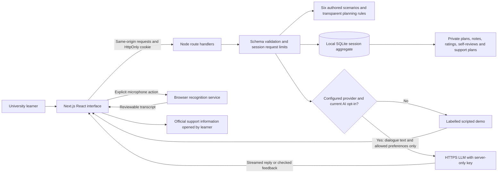
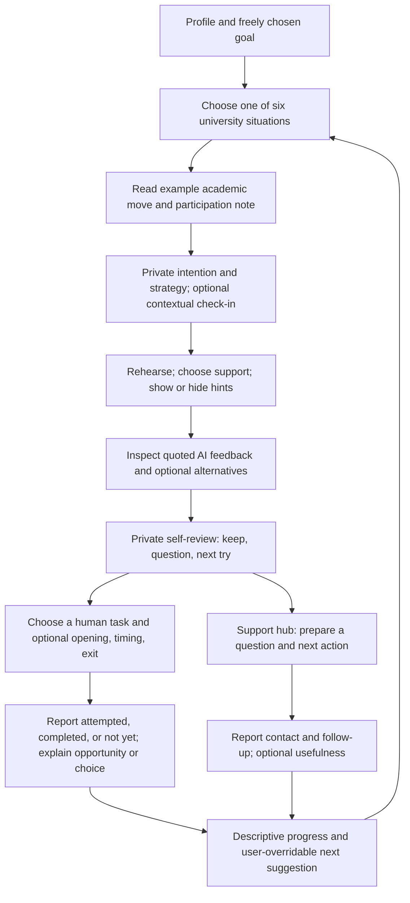
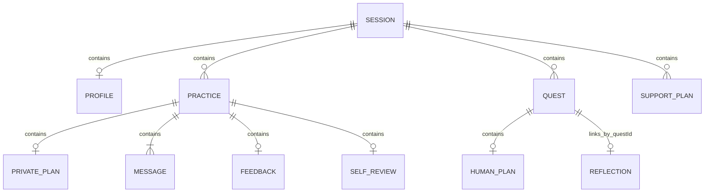

# SpeakUp AI — system design and educational rationale

Updated 4 November 2026, Hong Kong time. The design separates private learner reflection, model-mediated rehearsal, and self-reported activity with people.

## Architecture and data boundaries



The private-data branch has no connection to the LLM. Plans, intention, selected strategy, multilingual private note, check-in ratings, self-review, human-task plan and support records stay in local storage on this server. Under current version-2 remote consent, a practice may send the separately chosen profile goal, support style, scenario, dialogue and previous AI coaching focus. A learner can still deliberately type information into a message and press Send; the private-note field itself is never automatically transmitted.

Runtime: Next.js App Router, React, TypeScript, Tailwind CSS, Radix Dialog, Lucide, Zod and Node built-in SQLite. The browser receives no model credential. Node 22.13+ is required for SQLite; use the version recommended in the current README. This is a single-process server with persistent files, not a static export or a completed serverless deployment.

## User journey



No actual human interaction is required during a demonstration. The app neither records a conversation with another person nor verifies that contact occurred. Listening intentionally and lacking an opportunity are distinguishable from unwanted silence, and neither is treated as a deficiency.

## Six scenario designs

| Scenario ID | Communicative focus | Boundary |
|---|---|---|
| seminar | Claim + example + invitation to respond | Class participation conventions vary |
| campus | Open question, consent to talk, respectful closing | A partner can be unavailable or decline |
| group | Explicit task, roles, deadline and agreement | Do not force quieter members to speak |
| office | State understanding, identify uncertainty, ask a prepared question | Check actual course instructions |
| feedback | Ask for one actionable comment on an argument or assignment | Conversation rehearsal, not essay generation or grading |
| lecture | Identify a missed point, request clarification, paraphrase and verify | AI dialogue does not verify the lecturer's intended meaning |

Each authored scenario has a visible academic/communicative move, participation note, suggested strategy and literature identifiers. These are curated design resources. There is no retrieval-augmented search over the supplied PDFs and no claim that the model has read the review in each conversation.

## AI and request workflow

1. The learner selects a scenario, local plan and support style. The initial scenario opener is authored, even in live mode. The session records whether subsequent replies are live or demo.
2. The server validates scenario, ownership, input length and practice state. An in-process session lock prevents conflicting mutations; a modest per-session limit protects the local prototype.
3. Without configuration and version-2 opt-in, deterministic scenario replies are clearly labelled scripted. They do not evaluate meaning.
4. Live chat sends role instructions, scenario move, selected support, the separately consented profile goal when applicable, previous coaching focus when applicable, recent stored dialogue and current text. It excludes the local plan, notes, check-ins and self-review. Tests exercise this exclusion for both chat and feedback calls.
5. DeepSeek thinking is explicitly disabled for short role-play. Chat and feedback have separate output budgets/timeouts. Chat streams through NDJSON. Only a complete successful response commits the message pair; cancellation, invalid output and provider errors leave a retryable draft. Request UUIDs prevent duplication after a lost response.
6. Feedback requests structured clarity, pragmatics, phrases, a voluntary next step and 1–2 exact learner quotations with alternatives/reasons. Schema and quote checks run before saving. They verify structure and attribution, not the correctness of a rewrite or a claim about academic content.
7. AI instructions prioritize communicative purpose, respect varieties of English and valid silence, and avoid native-speaker ideals, diagnosis, ability ranking or claimed learning gains. Prompt instructions remain fallible safeguards; human review is still needed.
8. Authored recommendations run separately from the model. Neither private ratings nor model feedback silently sets a learner's challenge.

The current API paths remain same-origin. Provider configuration and connection checks reveal status and response metadata, never a credential. A small connection test sends a fixed prompt rather than a learner profile.

## Storage model



The physical SQLite table stores one JSON aggregate per anonymous browser session:

```sql
CREATE TABLE sessions (
  id TEXT PRIMARY KEY,
  state TEXT NOT NULL,
  updated_at TEXT NOT NULL
);
```

| Entity | Key fields and interpretation |
|---|---|
| Profile / baseline | Nickname, initial confidence/apprehension, contexts, goal, weekly preference, support, independent remote/voice consent; starting-confidence reference retained separately |
| Practice | Scenario, messages, mode, optional support/goal/coaching focus, receipts, timestamps, feedback, optional local plan and self-review |
| Private plan | Intention, one strategy, optional multilingual note, optional contextual confidence/willingness 1–5 |
| Self-review | Takeaway, next try and optional contextual ratings; no automatic gain score |
| Message / feedback | User text up to 1,200 characters; up to 20 user turns per practice; feedback quotations must match a user turn |
| Quest / human plan | Chosen scenario and step 1–3, status; optional opening, timing/place and exit; one active quest |
| Reflection | Outcome, confidence, opportunity, barrier, chosen listening where relevant, strategy, feedback use, learning and next step; linked by quest ID |
| Support plan | Support role, prepared question, next action, planned/contacted/followed-up status, optional usefulness 1–5; self-reported |

Optional new fields preserve compatibility with existing session aggregates. Export and local deletion cover the aggregate, including private notes and support plans. Writes use prepared statements, WAL and `BEGIN IMMEDIATE`; remote calls occur outside transactions. Cookie expiry and startup cleanup are not a scheduled retention guarantee, and external provider records or filesystem backups have separate lifecycles.

## Recommendation policy

- Keep an accepted quest's scenario and chosen level.
- Otherwise preserve the latest learner-chosen quest level; use step 1 only as an initial small suggestion.
- After a finished rehearsal, retain its scenario until a subsequent reflection linked to a quest in that same scenario. A reflection from another scenario does not clear this link.
- Otherwise match selected contexts and prefer another recent scenario where possible.
- Explain the planning rule and allow any scenario or level. Global confidence, nervousness, completion count, lack of opportunity and chosen listening do not determine difficulty.

This is a user-overridable planning heuristic. It is not a proficiency estimator, learned adaptive model or psychological judgment.

## Research-to-design rationale

| Basis | Design interpretation | Remaining question |
|---|---|---|
| WTC situational framework; Wang & Moskal (2019) | Situation-specific rehearsal and respect for intentional listening / structural exclusion | Does the student want to speak here, and is there room to do so? |
| Shi (2018) | Explicit plan, selected strategy, hints under learner control, later self-review | Strategy and self-efficacy were associated; is this workflow useful in the local task? |
| Zhou et al. (2022); Krsmanovic (2022) | Visible academic moves and clarification/feedback scenarios | Do the examples fit actual disciplinary expectations? |
| Bastien et al. (2018); Ravichandran et al. (2017) | Prepared support question, real service information and follow-up | Does the learner find appropriate, usable support? |
| Wang et al. (2018) | Keep language practice and using English for academic tasks conceptually distinct | Can any rehearsed strategy be used in a genuine chosen task? |
| Experiential learning; self-determination theory | Optional action, reflection, next choice and willing human partners | Do forms and targets support agency or feel like compliance? |

The corpus supplies associations and situated accounts, not an efficacy trial of this implementation. Evidence appraisal considers method, measurement, confounding, context and relevance, alongside sample size; see the [source-by-source evidence matrix](08-literature-evidence-matrix.md). Short in-app ratings are not validated WTC, anxiety or proficiency measures.

## Support, accessibility and deployment

The Support hub links to official [EdUHK CLE consultation information](https://www.eduhk.hk/cle/activities/consultat) and [SAO peer mentoring information](https://www.eduhk.hk/sao/en/info/csla/peer_mentors_amp_ambassadors/peermentoringprogramme/overview_of_scheme). Learners check current booking rules and eligibility. The app does not book, send a request, match peers, or guarantee discipline-specific support.

The interface uses labelled controls, semantic headings, keyboard focus, modal focus management, a text fallback, responsive navigation and reduced-motion support. Primary-navigation translation is partial; formal WCAG conformance and user voice testing are not established. Voice requires explicit enabling and microphone action; browser processing may be remote.

The local server uses anonymous sessions, not institutional accounts. Text is not encrypted at rest. Public university deployment would need authenticated ownership, protected durable storage, HTTPS/session security, retention operations, provider governance, accessibility review and global quotas. Teacher dashboards, automatic speech assessment and cross-device collaboration are future work.
