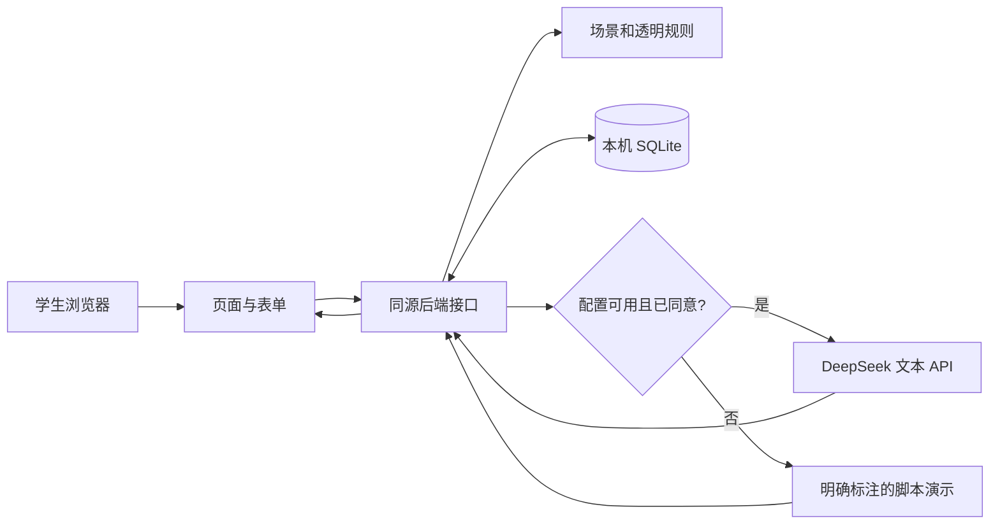
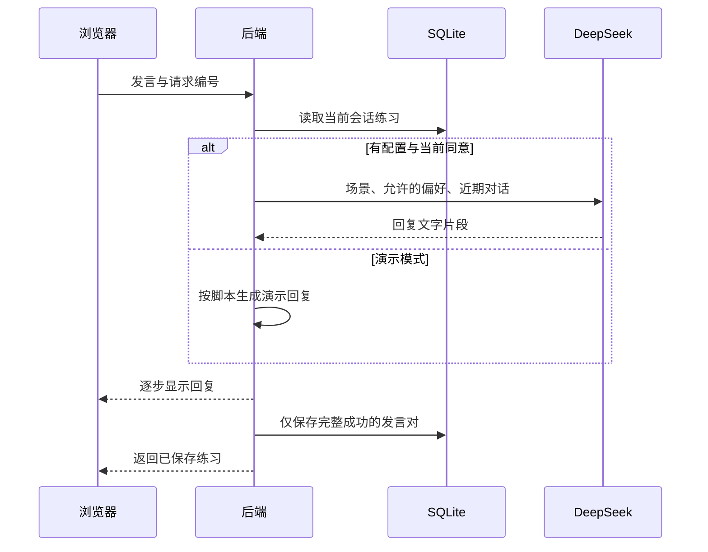

# SpeakUp AI 项目原理、开发过程与完整运行讲解

本手册供没有计算机专业背景的组员理解项目，依据仓库现有源码及已有开发记录整理，更新于 2026 年 11 月 7 日。它解释“我们做了什么、为什么这样设计、点击后实际发生什么”。四人分工、600 秒时间安排、英文讲稿和问答请配合 [展示排练手册](11-presentation-rehearsal-zh-en.md) 使用。

## 一、先用一句话说明项目

SpeakUp AI 帮助大学生为自己想参与的英语学术或校园交流做准备：先明确问题与策略，再进行 AI 情境排练，判断反馈，最后自主选择真人互动或学校支持，并记录后续经历。

它解决的是一个具体环节：学生可能知道一些英语，却不清楚如何加入讨论、澄清讲课内容或向老师索取有用反馈。困难也可能来自课堂节奏、隐性学术规则、没有话语空间或支持渠道不合适。因此，产品目标不能简化为“让所有学生多说英语”。选择倾听、暂时退出或使用其他语言都可以合理。

文献推动了这次范围调整。写作与学术语篇需求在多项研究中突出，我们增加了“请求具体写作反馈”，但没有把项目变成论文代写器；有关策略和求助的研究启发计划、反思与跟进，但相关关系不能证明功能有效。WTC（沟通意愿）、体验式学习和自我决定理论提供设计视角，应用中的简短评分不是经过验证的 WTC 量表。逐篇来源与校正见 [文献证据矩阵](08-literature-evidence-matrix.md)。原始论文和课程 PDF 不随公开源码分发。

## 二、开发过程应当怎样解释

下面是根据现有文档和代码重建的开发阶段，不是声称保存了每一分钟的开发日志。

**第一阶段是界定要求。** 结合课程要求、本组四人安排和用户对可运行作品的需求，确定研究依据、软件闭环与评价方案。先完成最小闭环：建档、选择情境、练习、反馈、真人任务、反思、记录。没有先编造使用者数据来填充漂亮图表。课程材料截止 11 月 9 日 23:59（香港时间），本组 11 月 16 日展示 10 分钟并回答 5 分钟问题；个人评价报告仍需真实利益相关者访谈，1,500 英文词，12 月 6 日 23:59 截止。

**第二阶段是搭建可重复演示的软件。** 用同一个 Next.js 项目提供页面与服务端接口，用 SQLite 保存匿名会话。先写明场景、角色、开场和示范回复，使没有模型密钥时也能走完流程。这一模式明确标为 Scripted demo，不能说固定脚本理解了学生的意思。

**第三阶段是接入真实模型。** 服务端增加模型调用、对话上下文、回复逐步显示、停止、草稿保留和重试保护；反馈另用结构化请求，并核对引用是否来自实际发言。11 月 3 日的历史记录记载 DeepSeek V4 Pro 连接、真实对话与反馈测试，见 [API 升级记录](07-live-ai-upgrade.md)。记录中的延迟、token 和测试数量只对应当时运行，不保证另一台电脑有相同结果。

**第四阶段是用文献修订教育设计。** 六个场景加入沟通动作与参与提醒；增加多语私人计划、自选提示、自主核验反馈、真人任务开场与退出、支持渠道跟进；取消根据信心和次数自动升级难度。11 月 4 日记录包括当时 20 项单元测试、3 条接口流程及浏览器检查，见 [文献驱动改进记录](09-literature-driven-upgrade.md)。这些证明某些软件路径在当时运行成功，没有证明学生能力提高。

**第五阶段是形成可审查的公开版本。** 保留源码、说明、测试和展示材料，排除真实配置、学习数据库、日志和原始附件。公开仓库让别人检查与复现设计，不意味着网站已经部署到互联网。本手册的源码核对也不是一次新的模型调用或用户实验。

### 制作与展示会用到哪些软件

| 工具 | 用途 | 组员需要理解的事 |
|---|---|---|
| Codex 等 AI 编程助手与代码编辑器 | 协助编写、修改和排查代码，整理材料 | 开发时的 AI 辅助应如实披露；它与学生在网页中调用的 DeepSeek 是两个环节 |
| Node.js 与 npm | Node 运行后端，npm 按锁文件安装依赖及执行命令 | `npm ci` 安装；`npm run dev` 开发；`npm run build` 生成生产版本；`npm start` 运行已构建版本 |
| 浏览器 | 显示页面、发送请求、查看流式回答与表单结果 | 浏览器页面关闭不等于后端已停止；本地后端由运行它的终端进程提供 |
| DeepSeek API 服务 | 接收获同意的文本并生成对话或反馈 | 需要联网和使用者自己的有效密钥，可能产生费用；密钥只放服务端 |
| SQLite | 保存本机匿名会话记录 | 不必另外安装 MySQL；当前使用 Node 内置 SQLite，不是云数据库 |
| Git 与 GitHub | Git 记录版本，GitHub 分享仓库、接收 fork 与协作修改 | 上传源码不是部署服务；GitHub Actions 执行软件检查，也不等于学习成效评价 |
| PowerPoint 或兼容软件 | 打开已有 PPT、查看讲者备注并排练 | 页面文字是提示，口语稿应结合实际按钮和演示节奏练习 |

组员可以把制作顺序说成：先定义学习问题与用户流程，随后写场景和数据格式，再把页面、接口、存储接起来，用明确的脚本跑通流程，然后接入真实模型与错误处理，依据文献修订设计，最后检查、记录并整理展示材料。这是对现有成果的过程说明，不是声称每位组员独立手写了所有代码。

## 三、前端、后端、数据库和 AI 各负责什么

可以把系统理解成一间练习室：前端是学生看见的桌面与表格；后端负责接收请求、核对权限和安排处理；数据库是记录柜；DeepSeek 是通过网络请来的对话与反馈服务。四者共同构成作品，只有页面截图不能代表整个系统。

| 部分 | 在本项目中的工作 | 主要源码 |
|---|---|---|
| 前端 React 页面 | 场景卡、计划窗口、对话、提示、反馈、反思、支持中心与进度 | `src/components/speakup.tsx`、`learning-tools.tsx` |
| 后端 Node 接口 | 验证表单、识别会话、检查练习归属、调用模型、保存结果 | `src/app/api/`、`src/lib/server.ts` |
| SQLite | 保存档案、练习、计划、反馈、任务、反思、短语和支持记录 | `src/lib/db.ts` |
| 教学规则 | 六个场景、数据格式、推荐顺序、统计口径 | `src/lib/domain.ts` |
| 模型适配层 | 组织提示、解析流式回复、处理错误、检查反馈引用 | `src/lib/ai.ts`、`provider.ts` |
| 启动与验证 | 安装/构建检查、选择本地端口、自动化测试 | `scripts/launch.mjs`、`tests/` |

数据库用一张 `sessions` 表，把一个浏览器会话的学习空间保存为结构化 JSON，连同更新时间存储。浏览器带着随机会话编号，后端据此读取对应记录；它不是实名账号，也不提供跨设备登录。刷新页面仍能看到已保存练习，是因为记录在服务端文件中，而不是因为 AI 记住了这个学生。清除浏览器会话、更换主机名或设备可能得到另一个学习空间。

## 四、点击到结果的十步运行流程

1. **进入页面。** 前端请求 `/api/state`。后端读取或建立随机会话 cookie，返回学习记录、推荐和公开的模型配置状态。返回内容没有密钥。“服务在运行”和“模型连接成功”是两件事，后者需单独测试。
2. **保存档案与权限。** 昵称、情境、目标、个人评分和两个独立权限通过状态接口验证后写入 SQLite。远程 AI 与浏览器语音各自可选。只配置密钥不会自动发送学生练习。
3. **选择场景并做私人计划。** 学生阅读沟通动作，填写意图、策略，可用中文构思并选择支持方式。开始请求传给 `/api/chat`，后端建立练习编号、保存计划和预写开场。这个开场在 Live AI 模式也由作者编写，不是一次模型生成。
4. **发送自己的发言。** 前端提交练习编号、场景、文字和本次请求编号。后端确认练习属于当前会话、尚未结束、输入符合限制。每次练习最多 20 次用户发言，每次最多 1,200 字符；这限制成本和处理范围，不代表能力等级。
5. **决定使用哪种回复。** 配置有效、未强制演示且有当前版本同意时才调用模型；否则使用脚本。已有 demo 练习不会因后来同意而变成真实 AI，需要新建练习。撤销权限会阻止后续真实调用。
6. **组织模型上下文并显示回复。** 后端加入角色、场景沟通目的、支持方式、获同意的独立学习目标，以及最近 20 条已存消息和新发言。20 条消息包含双方话语，不等于完整 20 轮。模型返回文字片段，后端转发给浏览器逐步显示；未完成的片段有明确标记。
7. **完整成功后才保存。** 回复完整且没有取消，才把用户发言与 AI 答复成对写入数据库。中途停止、空答案、超时或被截断不能当成成功。未发送草稿保存在当前标签页。相同请求编号的安全重试会检查已保存结果，减少断网重发导致的重复；修改文本后属于新请求。临时失败不会偷偷换成假装真实的脚本答案。
8. **结束并请求反馈。** 至少已有一次用户发言，才能调用 `/api/feedback`。后端另发反馈请求，要求清晰度、互动选择、短语、下一步以及原句/替代表达/理由。检查格式和引用成功后保存；再次请求已保存反馈会返回现有结果。
9. **学生判断并安排下一步。** 自主反思通过状态接口保存，学生可写“保留什么、质疑什么、下次改什么”。再练一次会把上轮 AI 的建议带入新练习，但不会带入私人反思。真人任务和支持计划也在此后建立，不会替学生联系任何人。
10. **现实经历与进度。** 学生实际经历后自报尝试、完成或尚未开口，说明机会、障碍与反馈使用。后端保存反思并结束当前任务；进度页重新统计。软件知道的是学生报告和系统活动，无法独立证实真人交谈质量。

## 五、六个场景为什么不是六个聊天皮肤

每个场景在 `domain.ts` 都有角色、开场、示范短语、演示分支、三个真人任务及研究编号。场景改变的是要完成的沟通动作，而不仅是图标颜色。

| 场景 | 学生练习的动作 |
|---|---|
| Join the discussion | 提出观点、给例子，再邀请回应 |
| Make a campus connection | 确认对方愿意交流，提问并有礼结束 |
| Find your voice in a team | 说清任务、分工、期限和共同意见 |
| Ask for a little clarity | 说明自己的理解，定位疑问，请求澄清 |
| Ask for useful writing feedback | 交代论点与证据，要求具体且可行动的反馈 |
| Clarify a missed lecture point | 区分听到与遗漏的部分，换句话确认理解 |

Guided、Natural、Stretch 是学生选的对话支持：分别偏向简短引导、自然追问、理由或不同观点。它们不是 CEFR 等级。短语提示可随时显示或隐藏；隐藏不会给学生升级，也没有所谓“已验证的智能支架衰减算法”。学术沟通动作是供讨论的例子，真正课程标准仍应向任课教师核对。

## 六、作业反馈场景的完整例子

以下是解释功能的假设例子，不是本次 API 实测回复，也不是真实参与者结果。学生想讨论“AI 提示如何支持学习”，先在私人计划写“问清我的论点需要什么例子”，策略选请求反馈，中文笔记可写“不要请 AI 替我编文献”。这几个字段不会自动传给 DeepSeek。

随后学生在聊天中主动发送：

> My claim is that AI hints can help students explain their reasoning. Could you tell me where I need a concrete example?

这时该文字会在 Live AI 模式下发给模型。它扮演讨论草稿的 tutor，可能追问学生准备使用什么例子，而不是有权认定某篇研究支持该论点。学生应使用自己实际读过的证据，不应接受模型临时编出的样本、引用或成绩。

结束后，反馈必须标出来自用户哪一次发言的原句。若模型声称引用第 1 次发言，后端会检查 `quote` 是否真是第 1 次用户文字中的连续片段。引文不匹配就拒绝保存。这能防止把未说过的话标为“你的原句”，却不能保证替代表达保留原意、语用建议合适或学术判断正确。

学生可以保存一句有用表达，也可在自评写“问题已具体，但需要真实老师判断论证”。再练一次只参考上轮 AI 反馈，不自动读取这段自评。之后选择向愿意的同伴或 tutor 问一个真实问题，计划开场、何时何地问、如何礼貌结束。在课堂软件演示中，真人结果应选 Not yet，支持状态保持 Planned。写好计划和看过服务网页不等于已经求助。

## 七、AI 收到什么，哪些只是本地记录

| 数据 | 当前代码的处理 |
|---|---|
| 用户按 Send 发出的练习文本、对话上下文 | Live AI 模式下发送；demo 不发给模型 |
| 场景、角色、示例沟通动作、支持方式 | 用来约束角色和回复方向 |
| 单独获同意的档案学习目标、上轮 AI 建议 | 可进入新练习提示 |
| 昵称、信心/紧张程度、私人计划的意图与策略 | 不由应用加入模型提示 |
| 私人多语笔记、情境评分、自主反思 | 只作为本地学习记录保存 |
| 真人任务计划、支持问题、联系与跟进记录 | 本地保存，不自动发送或预约 |
| 模型密钥 | 仅服务端配置使用，不返回页面 |

“本地”指运行服务的电脑，不是加密保险箱；能读取该电脑文件的人仍可能读取数据库。导出会包含自己的私人记录，删除当前会话不等于撤回已发给外部服务的副本。30 天 cookie 与启动时清理旧记录也不是每天定时执行的删除服务。

可选语音使用浏览器 Web Speech 功能，不是 DeepSeek 的语音模型。浏览器识别把声音转成可修改文字，学生检查并发送；浏览器/操作系统可能把声音交给自己的服务处理。Listen 则用浏览器语音合成朗读回复。SpeakUp 不存音频，也不分析发音准确率；不支持语音时可以打字，现场不应依赖麦克风成功。

## 八、真人任务、支持中心与推荐如何工作

真人任务每个场景有三个自选步骤，同一时间只能接受一个。学生可保存开场、时间地点和退出方式，之后提交一次反思。选择倾听时必须用 Not yet，页面显示 Chose to listen；只有报告实际尝试或完成口头互动才计入 speaking attempts。这不把倾听贬为失败。

Support hub 的价值是把“应该去求助”变成可执行的问题：找课程教师、同专业同伴，还是语言支持？具体问什么？下一步查何处或准备什么？先保存 Planned，实际联系后可记 Contacted，按建议做过后续再记 Followed-up，并可评价是否有用。官方链接只是供用户检查资格与预约条件，不会保证名额或替用户发消息。

推荐由明确规则决定，不由 DeepSeek 推断：优先保留已接受任务；没有活动任务时保持最近一次学生选的步骤，首次才建议 step 1。刚完成排练可继续指向同一情境，直到该情境的后续任务反思；否则在所选情境内换一个建议。信心高、完成次数多、没有机会和选择倾听都不会自动改变难度。进度统计也把 AI 练习、自评、真人尝试、倾听和支持跟进分开，不合成为“能力提升分”。

## 九、组员如何复现并稳定演示

先按 [README](../README.md) 安装兼容 Node 版本，在项目目录运行 `npm ci`，再运行 `npm run dev`。默认在本地 4311 端口打开；`npm run launch` 会检查依赖和构建，并在必要时选择相邻端口。以终端实际打印地址为准。前台运行时需保留终端，`Ctrl+C` 停止；公开 GitHub 仓库本身不会替你启动 Node 后端。

演示模式无需模型密钥。真实 AI 则由使用者在自己的本机配置文件中填写服务端设置，重启后在 Settings 测试连接、明确同意，再开始新练习。不要在聊天、投影或仓库中展示真实密钥。若另一份 SpeakUp 已在相关端口运行，启动器可能复用它；修改代码后应确认打开的是预期版本。`localhost` 与 `127.0.0.1` 的浏览器会话可能不同，临时看不到旧记录先核对地址。

展示前只准备一个简短例子：场景、私人计划、一次提问、反馈原句、自评、真人或支持计划。提前安装依赖并构建，备好标注为软件演示的截图。真实服务失败时先看错误并保留草稿，可安全重试；若改用 demo，明确说明模式变化。离线脚本仍需已启动的本地服务器；服务器也失败时用截图解释，不假装正在实时调用。

## 十、展示时必须说清的技术与研究边界

AI 的实际贡献是根据近期对话生成回应，并给出带引用的文字反馈。团队完成的是教育流程、提示设计、模型接口适配、验证、存储与界面，而不是训练了一个新的大模型。项目没有修改 DeepSeek 权重，没有微调，没有向量数据库，也没有把 30 篇 PDF 自动检索后交给模型回答；文献通过作者编写的场景与设计体现。

它也没有学校账号、跨设备同步、正式多人在线部署、教师审核后台或自动发音评分。匿名 cookie 与本地文件适合课程原型，公开服务还需要认证、数据治理、配额与运维。提示可以要求不编造，却不能消除幻觉；精确引文核验也不是事实核查。

因此最准确的项目结论是：我们做出了可运行、可检查且有文献理由的学习支持原型，并能说明软件如何工作、尚未证明什么。真实 API 成功和自动化测试说明技术可行；是否适合本校学生、支持是否真正可及、是否帮助自主参与，仍需真实访谈与后续研究。个人报告应使用 [评价包](05-evaluation-pack.md) 收集真实证据，不能把示例、截图、前后评分变化或模型调用成功写成学习成效。
